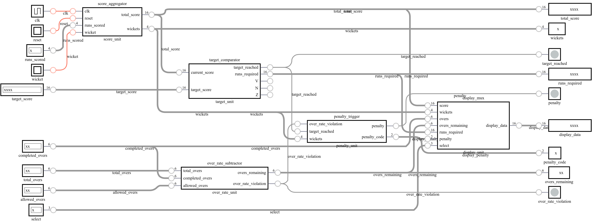

# 🏏 T20 Match Analytics & Penalty Engine

<p align="center">
  <strong>A Modular Verilog-Based Digital System for T20 Cricket Match Analytics</strong>
</p>

<p align="center">
  
  
  
  
</p>

## 📌 Overview

**T20 Match Analytics & Penalty Engine** is a digital systems project developed using Verilog HDL to demonstrate the design and integration of multiple hardware modules for cricket match analytics.

The system combines score aggregation, target comparison, over-rate monitoring, penalty detection, and display multiplexing into a single integrated circuit. Each component is developed and tested independently before being connected through a top-level module.

The project also includes individual and integrated testbenches, simulation waveform files, and DigitalJS circuit visualizations to support testing, debugging, and hardware-design demonstrations.

## 🎯 Project Objectives

- Design reusable digital modules using Verilog HDL.
- Implement arithmetic and comparison logic for match analytics.
- Integrate five hardware components into one top-level circuit.
- Develop testbenches for individual modules and the complete system.
- Simulate and inspect signal behavior using Icarus Verilog and VCD waveforms.
- Visualize hardware structure using DigitalJS.
- Apply hierarchical design principles to a practical sports analytics scenario.

## 🏗️ System Architecture

The top-level module, `t20_match_analytics`, connects the five main hardware components.

```text
                 ┌─────────────────────────────┐
                 │  t20_match_analytics_tb     │
                 │       Integrated Testbench  │
                 └──────────────┬──────────────┘
                                │
                 ┌──────────────▼──────────────┐
                 │     t20_match_analytics     │
                 │        Top-Level Module     │
                 └──────────────┬──────────────┘
                                │
          ┌─────────────┬───────┴───────┬─────────────┐
          │             │               │             │
   ┌──────▼──────┐ ┌────▼────────┐ ┌────▼────────┐ ┌──▼──────────┐
   │    Score    │ │  Over-Rate  │ │   Target    │ │   Penalty   │
   │ Aggregator  │ │ Subtractor  │ │ Comparator  │ │   Trigger   │
   └─────────────┘ └─────────────┘ └─────────────┘ └─────────────┘
                                │
                       ┌────────▼─────────┐
                       │ Display           │
                       │ Multiplexer       │
                       └───────────────────┘
```

*The diagram illustrates the conceptual hierarchy. Actual signal connections and module behavior are defined by the Verilog source files.*

## ⚙️ Hardware Components

### 1. Score Aggregator

**Source:** `Score_Aggregator/score_aggregator.v`

Processes match-scoring inputs and produces the score and wicket information specified by its module interface.

### 2. Over-Rate Subtractor

**Source:** `Over-Rate_Subtractor/over_rate_subtractor.v`

Implements subtraction logic to calculate the over-rate difference used by the system's monitoring and penalty-related logic.

### 3. Target Comparator

**Source:** `Target_Comparator/target_comparator.v`

Compares the current score against the target score and determines whether the target has been reached.

Key outputs include:

- `target_reached` — indicates whether the current score meets or exceeds the target.
- `runs_required` — represents the remaining runs needed to reach the target.
- `V`, `N`, and `Z` — status flags associated with the comparator's subtraction logic.

The comparator uses a 16-bit score representation in the updated design.

### 4. Penalty Trigger

**Source:** `Penalty_trigger/penalty_trigger.v`

Implements the penalty-triggering conditions defined by the module's inputs and logic.

### 5. Display Multiplexer

**Source:** `Display_Multiplexer/display_mux.v`

Selects the match information to be presented at the output according to the selection input.

### 6. Top-Level Integration

**Source:** `t20_match_analytics.v`

Instantiates and connects the five component modules into a unified hardware system.

The integrated module connects score information, wickets, completed overs, overs remaining, runs required, penalty information, and display-selection signals according to the design interfaces.

## 🖼️ Circuit Visualization

DigitalJS circuit files and circuit images are included in the repository to help visualize the individual hardware modules and the integrated design.

### Integrated Circuit

If the root-level `circuit.png` represents the complete system, it can be displayed here:



### Individual Module Circuits

Each component directory contains its own circuit visualization where available.

| Component | Circuit Image |
|---|---|
| Score Aggregator | [`Score_Aggregator/circuit.png`](Score_Aggregator/circuit.png) |
| Over-Rate Subtractor | [`Over-Rate_Subtractor/circuit.png`](Over-Rate_Subtractor/circuit.png) |
| Target Comparator | [`Target_Comparator/circuit.png`](Target_Comparator/circuit.png) |
| Display Multiplexer | [`Display_Multiplexer/circuit.png`](Display_Multiplexer/circuit.png) |
| Penalty Trigger | [`Penalty_trigger/circuit.png`](Penalty_trigger/circuit.png) |

DigitalJS files are included alongside the corresponding Verilog modules for circuit visualization and inspection.

## 🧪 Verification and Simulation

The project includes individual module testbenches and an integrated testbench.

### Individual Module Testing

Each component can be tested independently using its respective testbench. For example, to test the target comparator, open a terminal in the `Target_Comparator` directory and run:

```bash
iverilog -g2012 -s target_comparator_tb -o comparator_tb.vvp target_comparator_tb.v
vvp comparator_tb.vvp
```

The testbench applies different current-score and target-score combinations to verify comparator behavior.

### Integrated System Testing

The integrated testbench, `t20_match_analytics_tb.v`, tests the combined design by applying inputs and observing the outputs of the top-level module.

Run the following commands from the repository root.

**Step 1 — Compile all required modules**

```bash
iverilog -g2012 -s t20_match_analytics_tb -o integrated_tb.vvp t20_match_analytics.v t20_match_analytics_tb.v Score_Aggregator/score_aggregator.v Over-Rate_Subtractor/over_rate_subtractor.v Target_Comparator/target_comparator.v Display_Multiplexer/display_mux.v Penalty_trigger/penalty_trigger.v
```

**Step 2 — Execute the simulation**

```bash
vvp integrated_tb.vvp
```

The testbench prints the simulation results to the terminal. If waveform dumping is enabled, a VCD file can be opened in GTKWave for further inspection.

> **Important:** Compile each module source file only once. The integrated testbench should not include `t20_match_analytics.v` with a Verilog `` `include `` directive when the same file is already supplied separately in the compilation command.

## 🛠️ Technology Stack

| Technology | Purpose |
|---|---|
| Verilog HDL | Hardware description and module design |
| Icarus Verilog | Compilation and simulation |
| GTKWave | Simulation waveform inspection |
| DigitalJS | Digital circuit visualization |
| Visual Studio Code | Development environment |
| Git | Version control |
| GitHub | Source-code hosting and collaboration |

## 📂 Repository Structure

```text
T20_Match_Analytics/
│
├── Display_Multiplexer/
│   ├── circuit.png
│   ├── display_mux.v
│   ├── display_mux_tb.v
│   ├── display_mux_tb.vvp
│   ├── display_mux.digitaljs
│   └── display_mux.vcd
│
├── Over-Rate_Subtractor/
│   ├── circuit.png
│   ├── over_rate_subtractor.v
│   ├── over_rate_subtractor_tb.v
│   ├── over_rate_subtractor_tb.vvp
│   ├── over_rate_subtractor.digitaljs
│   └── over_rate_subtractor.vcd
│
├── Penalty_trigger/
│   ├── circuit.png
│   ├── penalty_trigger.v
│   ├── penalty_trigger_tb.v
│   ├── penalty_trigger_tb.vvp
│   ├── penalty_trigger.digitaljs
│   └── penalty_trigger.vcd
│
├── Score_Aggregator/
│   ├── circuit.png
│   ├── score_aggregator.v
│   ├── score_aggregator_tb.v
│   ├── score_aggregator_tb.vvp
│   ├── score_aggregator.digitaljs
│   └── score_aggregator.vcd
│
├── Target_Comparator/
│   ├── circuit.png
│   ├── target_comparator.v
│   ├── target_comparator_tb.v
│   ├── target_comparator_tb.vvp
│   ├── target_comparator.digitaljs
│   └── target_comparator_tb.vcd
│
├── circuit.png
├── integrated_tb.vvp
├── README.md
├── Submission_Report.pptx
├── t20_match_analytics.v
├── t20_match_analytics_tb.v
├── t20_match_analytics_tb.vcd
└── t20_match_analytics.digitaljs
```


## 📄 Submission Report

The project report/presentation is available in the repository:

[**View Submission Report (PPTX)**](Submission_Report.pptx)

## 👥 Team Members

This project was developed collaboratively as part of a digital systems design project.

| Team Member | Contribution |
|---|---|
| Gireesh V. Pai | Target Comparator and system integration |
| Rithesh Taparia | Display Multiplexer |
| Megha S | Score Aggregator |
| Vamika Khemka | Penalty Trigger Logic |
| Navika Kapur | Over Rate Subtractor |


## 📚 Learning Outcomes

This project provided practical experience in:

- Hierarchical hardware design and module instantiation.
- Arithmetic and comparison logic in digital circuits.
- Integrating independent Verilog modules into a unified design.
- Developing and running simulation testbenches.
- Debugging compilation and module-dependency errors.
- Analyzing signal behavior through waveform files.
- Visualizing digital hardware with DigitalJS.
- Managing a collaborative project with Git and GitHub.

## 🚀 Future Enhancements

Potential improvements include:

- Expanding match-state tracking and innings-management functionality.
- Adding more comprehensive automated verification scenarios.
- Improving the display encoding of match statistics.
- Adding more detailed timing and waveform analysis.
- Exploring FPGA implementation and physical hardware demonstrations.

## 📜 License

This project is intended for educational and academic demonstration. A license can be added to define the terms under which others may reuse, modify, or distribute the source code.

---

<p align="center">
  <strong>Built with Verilog HDL, tested through simulation, and visualized with DigitalJS. 🏏</strong>
</p>